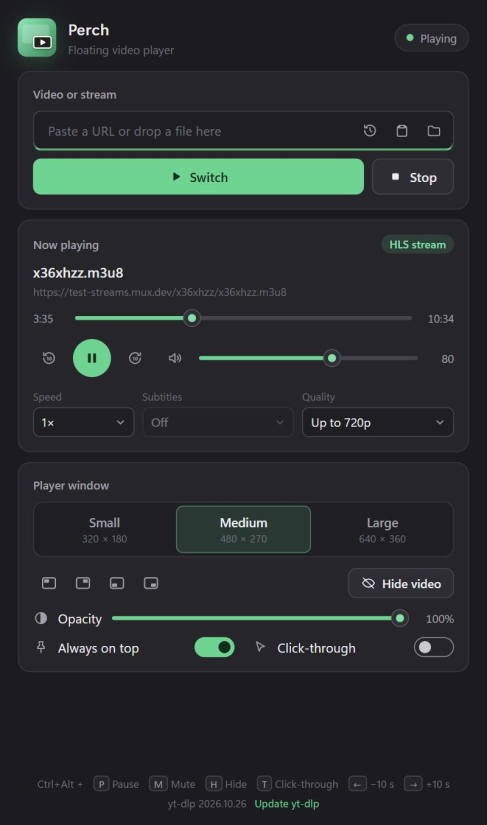

<p align="center">
  
</p>

<h1 align="center">Perch</h1>

<p align="center">
  A minimal floating picture-in-picture video player for Windows 11.<br>
  Paste a link, and the video perches in a small always-on-top window.
</p>

<p align="center">
  
</p>

## Features

- **Videos and live streams:** YouTube, Twitch, direct video URLs, HLS (`.m3u8`), DASH (`.mpd`),
  RTMP/RTSP/SRT and local files (file dialog or drag & drop onto the window).
- **Floating player window:** borderless, always on top (toggleable), freely movable and
  resizable with the aspect ratio kept, plus Small / Medium / Large presets.
- **Controls:** play/pause, volume, mute, a timeline with seeking and ±10 s skip for videos,
  playback speed (0.5×–2×) and subtitle tracks; live streams are marked "LIVE".
  Hovering the video shows mpv's own control bar.
- **Window tricks:** snap the video to a screen corner, adjust its opacity, hide it while the
  audio keeps playing, or turn on click-through so mouse clicks reach the window behind it.
- **Global hotkeys:** <kbd>Ctrl</kbd>+<kbd>Alt</kbd> + <kbd>P</kbd> pause, <kbd>M</kbd> mute,
  <kbd>H</kbd> hide/show video, <kbd>T</kbd> click-through, <kbd>←</kbd>/<kbd>→</kbd> ±10 s –
  work even when Perch is in the background.
- **Remembers you:** volume, size, quality, opacity, window position and the last 10 played
  links are kept in `%APPDATA%\Perch\settings.json`. A video link in the clipboard is offered
  for playback when you switch to Perch.
- **Quality setting:** up to 480p / 720p (default) / 1080p / best for YouTube and Twitch.
- **One-click yt-dlp update** when YouTube changes something (via WinGet if installed that way).
- **Light on resources:** hardware decoding, quality-capped streams, bounded buffer.
- **Native on ARM64 and x64:** Snapdragon-based Windows PCs run Perch without emulation.

## Requirements

Perch uses [mpv](https://mpv.io) for playback and [yt-dlp](https://github.com/yt-dlp/yt-dlp)
for YouTube and Twitch. Install both once, e.g. with WinGet:

```powershell
winget install shinchiro.mpv
winget install yt-dlp.yt-dlp
```

Perch looks for them in this order: the environment variables `PERCH_MPV` / `PERCH_YTDLP`,
next to `Perch.exe`, common install folders (including WinGet), then `PATH`.
If something is missing, the app tells you which command to run.

WebView2 is already part of Windows 11; the installer adds it on older systems.

## Install

Download the latest release from the **Releases** page:

| File | Use |
|---|---|
| `Perch-amd64_arm64-installer.exe` | Installer – picks ARM64 or x64 automatically |
| `Perch-arm64.exe` | Portable, for ARM64 PCs (e.g. Snapdragon X) |
| `Perch-amd64.exe` | Portable, for x64 PCs |

## Using the player window

- Drag the video to move the window, drag an edge to resize.
- Move the mouse over the video to show the control bar; it fades out after about a second.
- Keyboard in the player: <kbd>Space</kbd> pause, <kbd>M</kbd> mute, <kbd>9</kbd>/<kbd>0</kbd>
  volume, <kbd>←</kbd>/<kbd>→</kbd> seek, <kbd>Q</kbd> close.

## Troubleshooting

YouTube changes its download protection often. If videos stop loading (for example with
HTTP 403), click **Update yt-dlp** at the bottom of the window, or run
`winget upgrade yt-dlp.yt-dlp`.

If the video window seems stuck because click-through is on, press <kbd>Ctrl</kbd>+<kbd>Alt</kbd>+<kbd>T</kbd>.

## Building from source

Requires Go (see `go.mod`), Node.js 22 and the [Wails v2 CLI](https://wails.io):

```powershell
go install github.com/wailsapp/wails/v2/cmd/wails@v2.17.0

wails dev                                                  # live development
wails build -platform windows/amd64,windows/arm64          # both EXEs in build/bin
wails build -platform windows/amd64,windows/arm64 -nsis    # plus installer (needs NSIS)
go test ./...                                              # after a build (embeds frontend/dist)
```

Pushing a tag such as `v1.0.0` makes the GitHub Actions workflow build everything and
publish a release.

## Project structure

| Path | Purpose |
|---|---|
| `main.go` | Wails window, single-instance lock, shutdown hook |
| `app.go` | Frontend bindings, `player:state` event |
| `internal/player/player.go` | mpv process lifecycle, state, controls |
| `internal/player/ipc.go` | Persistent JSON IPC over a named pipe (request IDs, events, timeouts) |
| `internal/player/win32.go` | Job object (no orphaned mpv), window sizing, corners, opacity, click-through |
| `internal/player/taskbar.go` | Groups the video window under Perch's taskbar icon |
| `internal/player/hotkeys.go` | Global Ctrl+Alt shortcuts |
| `internal/player/prefs.go` | Settings and recently played list |
| `internal/player/ytdlp.go` | yt-dlp version check and update |
| `internal/player/source.go` | URL/file validation and source detection |
| `internal/player/locate.go` | Locates `mpv.exe` / `yt-dlp.exe` |
| `frontend/` | UI (vanilla JS + CSS, built with Vite) |
| `frontend/src/assets/logo.svg` | Logo source; `build/appicon.png` is rendered from it, and Wails generates `build/windows/icon.ico` from that |

## License

[MIT](LICENSE)
